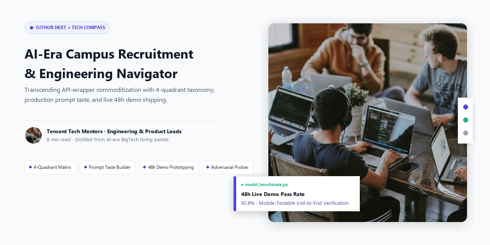
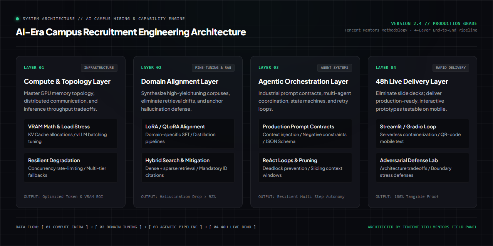

<div align="right">
  <a href="README_zh.md">简体中文</a> | <b>English</b>
</div>

<div align="center">



# AI-Era Campus Recruitment Navigator & Engineering Engine
### Engineering insights distilled from Tencent technical leads and hiring mentors

**A systematic framework to transcend API-wrapper commoditization, master prompt taste, and ship live 48h demos.**

<p align="center">
  <a href="https://github.com/Daokexun/ai-campus-navigator/stargazers"></a>
  <a href="LICENSE"></a>
  <a href="llms.txt"></a>
  <a href="cli/taste_evaluator.py"></a>
  <a href="cheatsheets/ai_campus_decision_tree.svg"></a>
  <a href="CONTRIBUTING.md"></a>
</p>

</div>

---

### 📖 Editorial Background

> **"In the era where AI is accessible to everyone, a new graduate's core competitive advantage is never about running an open-source tutorial script. It is about understanding the commercial causalities behind code, mastering production-grade prompt taste, and delivering live testable systems."**  
> — Tencent Technical Mentors & Hiring Panels

Across AI-era campus hiring, technical candidates consistently stumble into three common blindspots:

1. **The API-Wrapper Trap**: Resumes saturated with "built an AI knowledge base using LangChain," yet freezing when asked about token budgets, VRAM allocations, or production p99 latency tradeoffs.
2. **Ambiguous Career Taxonomy**: Lacking clear distinction between Infrastructure (Infra), Fine-Tuning, Agentic Workflows, and Application-layer enablement, leading to unfocused applications.
3. **Screenshot-Only Portfolios**: Presenting static screenshots and terminal logs instead of end-to-end, live interactive prototypes that hiring managers can test on their phones during the interview.

This playbook synthesizes guidance from senior engineering interviewers: **4-Quadrant Role Taxonomy, Prompt Taste Building, 48-Hour Live Demo Prototyping, and Adversarial Architecture Defense**.

---

### ⚡ Instant CLI Quickstart

Test your prompt taste or audit architecture contracts in under 15 seconds:

```bash
# 1. Clone repository
git clone https://github.com/Daokexun/ai-campus-navigator.git
cd ai-campus-navigator

# 2. Run instant Prompt Taste & Architecture depth evaluation
python cli/taste_evaluator.py --taste-test

# 3. Evaluate a custom prompt
python cli/taste_evaluator.py --eval "Your custom prompt string here"
```

---

### 🏛️ Four Core Pillars

| Pillar | Strategic Purpose | Core Execution Mechanism |
| :--- | :--- | :--- |
| **01 4-Quadrant Role Taxonomy**<br>`prompts/01_ai_role_radar.md` | Align candidate capabilities with high-leverage roles | Classifies positions across Infrastructure, Domain Fine-Tuning, Agent Systems, and App Enablement. |
| **02 Production Prompt Taste**<br>`prompts/02_prompt_taste_evaluator.md` | Elevate from novice queries to robust contracts | Replaces vague prompts with multi-modal context injection, negative edge constraints, and strict schema validation. |
| **03 48-Hour Demo Loop**<br>`prompts/03_demo_showcase_loop.md` | Ship testable prototypes in under 48 hours | Uses Streamlit and Gradio on serverless containers to deliver mobile-accessible, live test environments. |
| **04 Technical Depth Probes**<br>`prompts/05_adversarial_interviewer_audit.md` | Defend against senior architectural challenges | Stress-tests VRAM memory math, throughput vs. latency tradeoffs, hallucination mitigation, and graceful degradation. |

---

### 📐 System Architecture Matrix

The following diagram illustrates the candidate journey from role classification to interactive demo deployment and panel defense:

<div align="center">
  
</div>

---

### 🌲 Ecosystem Decision Tree & 1-Page Cheatsheet

Downloadable high-density printable vector artifacts for rapid review:
- 📄 **1-Page Cheat Sheet**: [`cheatsheets/ai_campus_cheatsheet.md`](cheatsheets/ai_campus_cheatsheet.md) (Formula equations, 10 hard negative prompt rules)
- 📊 **Vector Decision Tree**: [`cheatsheets/ai_campus_decision_tree.svg`](cheatsheets/ai_campus_decision_tree.svg)

<div align="center">
  
</div>

---

### 🥊 Tactical Breakdown: API Wrapper Novice vs. Engineering Candidate

| Interview Challenge | Generic Wrapper Novice | Production-Grade Candidate |
| :--- | :--- | :--- |
| **"How do you mitigate hallucinations in your RAG pipeline?"** | Naive prompt pleading: "We added 'do not make things up' to the prompt and ran default LangChain vector search." | **3-Tier Production Defense**: "Prompt pleading cannot reliably eliminate hallucination. We enforce three layers: 1. **Retrieval**: Hybrid dense + sparse search with a strict similarity threshold; 2. **Inference**: Strict citation constraints linking outputs to passage IDs; 3. **Post-Processing**: Fact-verification validator that triggers graceful degradation if entity matching drops below 85%." |
| **"How does KV Cache scale in multi-GPU inference?"** | "It uses GPU memory and we just run vLLM." | **Exact Memory Equation**: "For each token, KV Cache consumes $2 \times 2 \times n_{layers} \times n_{heads} \times d_{head} \times \text{precision bytes}$. With fp16, a 32-layer 70B model requires ~1.3MB per token per request across layers. At batch size 64 and context length 4096, KV Cache alone consumes 341GB VRAM, necessitating PagedAttention and tensor parallelism across at least 8x A100/H100 GPUs." |

---

### 🤖 AI Coding Agent Integration (`llms.txt`)

This repository is optimized for autonomous coding agents (Claude Code, Cursor, GitHub Copilot).
- **Curated Rules**: Feed [`llms.txt`](llms.txt) to your AI agent to audit your interview answers.
- **Full Specification**: Reference [`llms-full.txt`](llms-full.txt) for end-to-end prompt engineering schemas.

---

### 📂 Repository Structure

```text
ai-campus-navigator/
├── assets/
│   ├── hero_poster_en.jpg           # English publication banner (1280x720)
│   ├── hero_poster_zh.jpg           # Chinese publication banner (1280x720)
│   ├── architecture.png             # 1280x640 High-Density Engineering Architecture
│   └── architecture_zh.png          # 1280x640 Chinese Engineering Architecture
├── cheatsheets/
│   ├── ai_campus_cheatsheet.md      # 1-page high-density quick reference
│   └── ai_campus_decision_tree.svg  # Printable vector diagnostic decision tree
├── cli/
│   └── taste_evaluator.py           # Interactive CLI Prompt Taste & Contract Evaluator
├── prompts/
│   ├── 01_ai_role_radar.md          # 4-quadrant role navigation workbench
│   ├── 02_prompt_taste_evaluator.md # Production prompt taste calibration
│   ├── 03_demo_showcase_loop.md     # 48-hour live demo shipping manual
│   ├── 04_qingyun_talent_matrix.md  # BigTech elite campus talent rubrics
│   └── 05_adversarial_interviewer_audit.md # 10 deep architectural interview probes
├── templates/
│   └── ai_portfolio_schema.json     # Candidate competency evaluation schema
├── evals/
│   └── rubric_100_ai_campus.json    # 100-point AI campus interview rubric
├── llms.txt                         # Curated AI Agent specification
├── llms-full.txt                    # Comprehensive specification
├── README.md                        # English documentation (current file)
└── README_zh.md                     # Chinese documentation
```

---

### 🌟 Star History & Community

<p align="center">
  <a href="https://star-history.com/#Daokexun/ai-campus-navigator&Date">
    
  </a>
</p>

### 📄 License & Community

This project is open-sourced under the [MIT License](LICENSE). Contributions from hiring managers, AI engineers, and educators are welcomed via [CONTRIBUTING.md](CONTRIBUTING.md).
