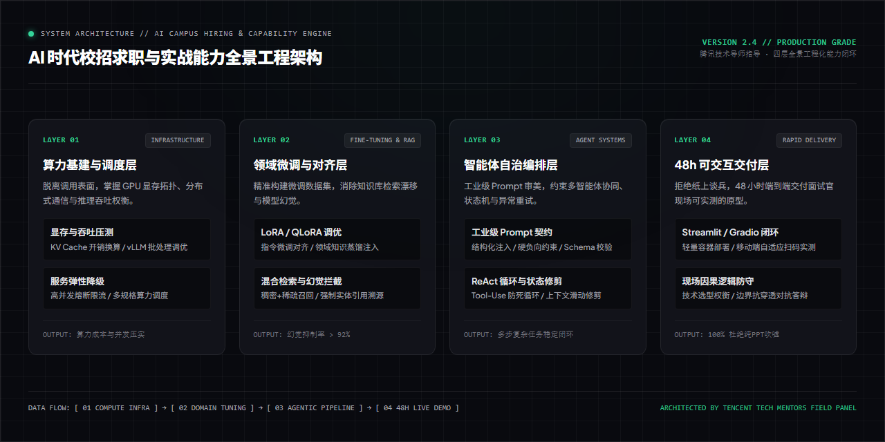

<div align="right">
  <b>简体中文</b> | <a href="README.md">English</a>
</div>

<div align="center">


# AI 时代校招生求职与实战能力重构指南
### AI-Era Campus Recruitment Navigator & Engineering Engine

**沉淀自腾讯技术与业务导师团队实战洞察 · 击破盲目调包内卷、重塑四象限岗位认知与 48h Demo 闭环**

<p align="center">
  <a href="https://github.com/Daokexun/ai-campus-navigator/stargazers"></a>
  <a href="LICENSE"></a>
  <a href="llms.txt"></a>
  <a href="cli/taste_evaluator.py"></a>
  <a href="cheatsheets/ai_campus_decision_tree.svg"></a>
  <a href="CONTRIBUTING.md"></a>
</p>

</div>

---

### 📖 导读与实战背景

> **“在 AI 人人可用的时代，校招生最大的壁垒绝不是‘跑通了开源代码’，而是能否理解代码背后的商业因果律、具备工程化落地能力与高质量的 Prompt 审美。”**  
> —— 腾讯技术与业务导师团队（鹅厂卧谈会）

当前 AI 浪潮下，技术校招与产品校招面临前所未有的同质化困境：

1. **“盲目调包，毫无壁垒”**：简历上清一色写着“调用 OpenAI / LangChain API 开发知识库”，面试官一问底层 Token 消耗、显存占用与并发延迟，瞬间哑口无言；
2. **“岗位认知极其模糊”**：分不清底层基建（Infra）、模型微调（Fine-Tuning）、智能体系统（Agentic Workflows）与赋能应用的区别，盲目海投导致精准度极低；
3. **“Demo 仅存在于 PPT 中”**：面试时只有截图或本地运行日志，无法提供任何可供面试官当场扫码实测的在线可交互原型。

本指南源于腾讯资深技术与产品面试官团队的一线指导，系统拆解**四象限岗位认知、Prompt 审美跃迁、48小时可交互 Demo 极速交付与底层技术深度防守**，助力校招生构筑不可替代的实战壁垒。

---

### ⚡ 15 秒开箱实测 CLI

本地无需繁琐配置，终端直接体验工业级 Prompt 契约与能力打分：

```bash
# 1. 克隆代码仓库
git clone https://github.com/Daokexun/ai-campus-navigator.git
cd ai-campus-navigator

# 2. 运行对比评测：学生调包提示词 vs 工业级生产契约
python cli/taste_evaluator.py --taste-test

# 3. 评估自己的提示词
python cli/taste_evaluator.py --eval "你编写的提示词内容"
```

---

### 🏛️ 四大核心支柱 (Core Capabilities)

| 模块 | 核心解决问题 | 一线实战落地打法 |
| :--- | :--- | :--- |
| **01 岗位四象限定位**<br>`prompts/01_ai_role_radar.md` | 跳出盲目调包陷阱，明确个人技术栈生态位 | 划分底层算力与分布式训练、垂直领域模型微调、业务级 Agent 编排、现有业务+AI 赋能 4 类生态位，精准对齐求职诉求。 |
| **02 Prompt 审美跃迁引擎**<br>`prompts/02_prompt_taste_evaluator.md` | 摆脱学生式模糊提问，撰写生产级指令 | 从“生成一段文案”跃迁至包含“结构化角色定义 + 上下文注入 + 负向硬性约束 + 容错防御 + JSON Schema 严格校验”。 |
| **03 48h 极速 Demo 交付闭环**<br>`prompts/03_demo_showcase_loop.md` | 告别纸上谈兵，现场提供手机可测原型 | 使用 Streamlit / Gradio 配合轻量云托管，48 小时内落地具备可测试性、异常处理与数据持久化的端到端应用。 |
| **04 架构深度探针与抗穿防守**<br>`prompts/05_adversarial_interviewer_audit.md` | 应对技术大牛 10 轮因果逻辑压力测试 | 针对显存开销换算、推理吞吐与延迟平衡、幻觉抑制、降级容灾方案提供严密推演逻辑。 |

---

### 📐 业务全景系统架构

下图展示了从四象限岗位定位、Prompt 工业化到 48h 原型交付与答辩防守的全景闭环：

<div align="center">
  
</div>

---

### 🌲 生态位决策树与一页纸速查卡

配备高清可打印矢量图与速查清单：
- 📄 **一页纸核心速查卡**：[`cheatsheets/ai_campus_cheatsheet.md`](cheatsheets/ai_campus_cheatsheet.md)（显存吞吐公式、10条硬负向规则）
- 📊 **矢量生态决策树**：[`cheatsheets/ai_campus_decision_tree.svg`](cheatsheets/ai_campus_decision_tree.svg)

<div align="center">
  
</div>

---

### 🥊 实战攻防对比：学生调包侠 vs 业务工程型候选人

| 面试考察点 | 普通调包应届生的表现 | 业务工程型候选人的高分答卷 |
| :--- | :--- | :--- |
| **面试官问：“你的大模型问答系统如何处理幻觉？”** | 泛泛而谈：“我们在 Prompt 里写了‘请根据事实回答，不要编造’，然后调了 LangChain 的默认 RAG 检索。” | **严密防御与兜底协议**：“单一 Prompt 约束无法彻底根除幻觉。我们在工程上采取三层防御：1. **召回阶段**采用语义检索+关键词倒排混合检索，设定相似度置信阈值；2. **推理阶段**强制要求模型输出引用的段落 ID，未引用的内容直接过滤；3. **兜底阶段**配置后验规则校验器，若关键实体不匹配则触发优雅降级，转人工兜底。” |
| **面试官问：“多卡推理时 KV Cache 如何估算？”** | 支支吾吾：“显存挺大的，跑 vLLM 默认参数就行。” | **精确实时显存换算**：“每个 Token 的 KV Cache 显存消耗公式为 $2 \times 2 \times n_{layers} \times n_{heads} \times d_{head} \times \text{精度字节}$。在 fp16 下，以 32 层 70B 模型为例，单 Token 跨层消耗约 1.3MB。当 Batch Size 为 64、上下文达到 4096 时，仅 KV Cache 就消耗 341GB 显存，必须借助 PagedAttention 和至少 8 卡张量并行分摊。” |

---

### 🤖 AI Coding Agent 原生就绪 (`llms.txt`)

本项目全面适配 Claude Code、Cursor、GitHub Copilot 等 AI 编程助手：
- **精选上下文规则**：将 [`llms.txt`](llms.txt) 引入 Cursor 规则库，快速模拟大厂评委对你的项目进行因果探针审核。
- **全量提示词规格**：参考 [`llms-full.txt`](llms-full.txt) 快速搭建工业级生产提示词契约。

---

### 📂 目录结构全览

```text
ai-campus-navigator/
├── assets/
│   ├── hero_poster_en.jpg           # 英文技术社论封面海报 (1280x720)
│   ├── hero_poster_zh.jpg           # 中文技术社论封面海报 (1280x720)
│   ├── architecture.png             # 1280x640 全景系统架构蓝图
│   └── architecture_zh.png          # 1280x640 中文系统架构蓝图
├── cheatsheets/
│   ├── ai_campus_cheatsheet.md      # 一页纸速查卡与硬负向规则清单
│   └── ai_campus_decision_tree.svg  # 可打印矢量求职生态位决策树
├── cli/
│   └── taste_evaluator.py           # 交互式 Prompt 审美与工程契约评测命令行工具
├── prompts/
│   ├── 01_ai_role_radar.md          # 岗位四象限定位工作台
│   ├── 02_prompt_taste_evaluator.md # 工业级 Prompt 审美跃迁引擎
│   ├── 03_demo_showcase_loop.md     # 48小时可交互 Demo 极速交付闭环
│   ├── 04_qingyun_talent_matrix.md  # 青云计划顶尖校招生画像与评鉴矩阵
│   └── 05_adversarial_interviewer_audit.md # 面试官视角对抗性深度审计探针
├── templates/
│   └── ai_portfolio_schema.json     # 候选人实战能力评估 Schema
├── evals/
│   └── rubric_100_ai_campus.json    # 100 分制 AI 校招评测基准
├── llms.txt                         # AI Agent 规范
├── llms-full.txt                    # 完整规范
├── README.md                        # 英文说明文档
└── README_zh.md                     # 中文说明文档 (当前文件)
```

---

### 🌟 Star History & 社区

<p align="center">
  <a href="https://star-history.com/#Daokexun/ai-campus-navigator&Date">
    
  </a>
</p>

### 📄 开源许可证与贡献

本项目采用 [MIT License](LICENSE) 开源。欢迎各大厂技术面试官、高校导师及求职同学共同参与共建，详见 [CONTRIBUTING.md](CONTRIBUTING.md)。
