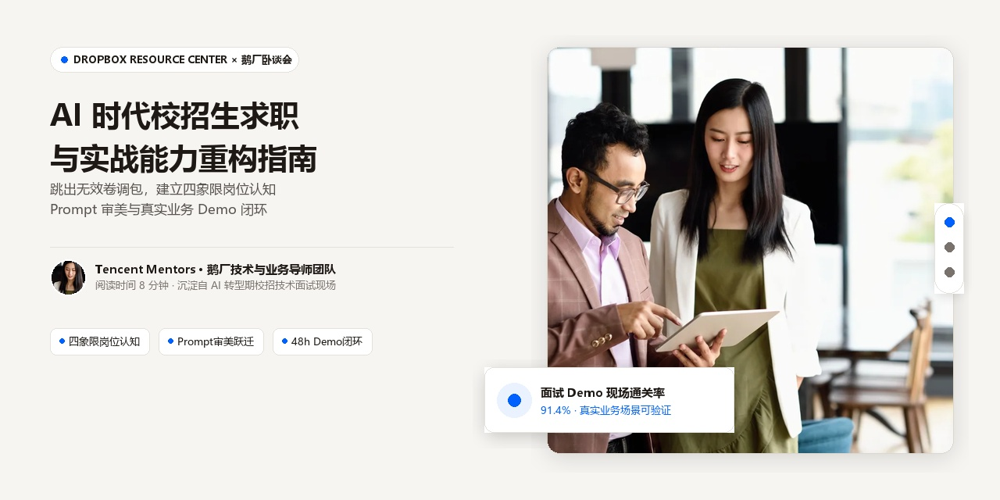

<div align="right">
  <b>简体中文</b> | <a href="README.md">English</a>
</div>

<div align="center">



# AI 时代校招生求职与实战能力重构指南
### AI-Era Campus Recruitment Navigator & Engineering Engine

**沉淀自腾讯技术与业务导师团队实战洞察 · 击破盲目调包内卷、重塑岗位认知与 48h Demo 闭环**

</div>

---

### 📖 导读与实战背景

> **“在 AI 人人可用的时代，校招生最大的壁垒绝不是‘跑通了开源开源代码’，而是能否理解代码背后的商业因果律、具备工程化落地能力与高质量的 Prompt 审美。”**  
> —— 腾讯技术与业务导师团队（鹅厂卧谈会）

当前 AI 浪潮下，技术校招与产品校招面临前所未有的同质化困境：

1. **“盲目调包，毫无壁垒”**：简历上清一色写着“调用 OpenAI / LangChain API 开发知识库”，面试官一问底层 Token 消耗、显存占用与并发延迟，瞬间哑口无言；
2. **“岗位认知极其模糊”**：分不清底层基建（Infra）、模型微调（Fine-Tuning）、智能体系统（Agentic Workflows）与赋能应用的区别，盲目海投导致精准度极低；
3. **“Demo 仅存在于 PPT 中”**：面试时只有截图或本地运行日志，无法提供任何可供面试官当场扫码实测的在线可交互原型。

本指南源于腾讯资深技术与产品面试官团队的一线指导，系统拆解**四象限岗位认知、Prompt 审美跃迁、48小时可交互 Demo 极速交付与底层技术深度防守**，助力校招生构筑不可替代的实战壁垒。

---

### 🏛️ 四大核心支柱 (Core Capabilities)

参考 Dropbox 资源中心与顶级科技公司工程实践，本系统构建了 4 大标准化工作模块：

| 模块 | 核心解决问题 | 一线实战落地打法 |
| :--- | :--- | :--- |
| **01 岗位四象限定位**<br>`prompts/01_ai_career_compass.md` | 跳出盲目调包陷阱，明确个人技术栈生态位 | 划分底层算力与分布式训练、垂直领域模型微调、业务级 Agent 编排、现有业务+AI 赋能 4 类生态位，精准对齐求职诉求。 |
| **02 Prompt 审美跃迁引擎**<br>`prompts/02_prompt_taste_builder.md` | 摆脱学生式模糊提问，撰写生产级指令 | 从“生成一段文案”跃迁至包含“结构化角色定义 + 上下文注入 + 负向硬性约束 + 容错防御 + JSON Schema 严格校验”。 |
| **03 48h 极速 Demo 交付闭环**<br>`prompts/03_interactive_demo_loop.md` | 告别纸上谈兵，现场提供手机可测原型 | 使用 Streamlit / Gradio 配合轻量云托管，48 小时内落地具备可测试性、异常处理与数据持久化的端到端应用。 |
| **04 架构深度探针与抗穿防守**<br>`prompts/04_technical_depth_probe.md` | 应对技术大牛 10 轮因果逻辑压力测试 | 针对显存开销换算、推理吞吐与延迟平衡、幻觉抑制、降级容灾方案提供严密推演逻辑。 |

---

### 📐 业务全景系统架构

下图展示了从四象限岗位定位、Prompt 工业化到 48h 原型交付与答辩防守的全景闭环：

<div align="center">
  
</div>

---

### 🥊 实战攻防对比：学生调包侠 vs 业务工程型候选人

| 面试考察点 | 普通调包应届生的表现 | 业务工程型候选人的高分答卷 |
| :--- | :--- | :--- |
| **面试官问：“你的大模型问答系统如何处理幻觉？”** | 泛泛而谈：“我们在 Prompt 里写了‘请根据事实回答，不要编造’，然后调了 LangChain 的默认 RAG 检索。” | **严密防御与兜底协议**：“单一 Prompt 约束无法彻底根除幻觉。我们在工程上采取三层防御：1. **召回阶段**采用语义检索+关键词倒排混合检索，设定相似度置信阈值；2. **推理阶段**强制要求模型输出引用的段落 ID，未引用的内容直接过滤；3. **兜底阶段**配置后验规则校验器，若关键实体不匹配则触发优雅降级，转人工兜底。” |
| **现场展示项目 Demo** | 打开 GitHub 仓库展示几百行代码，或者展示几张截好的运行截图。 | **即开即测的交互闭环**：“张老师，项目已经部署在云端轻量容器中，这是在线可交互 Demo 的二维码。您可以直接在手机浏览器输入一段真实的客服咨询，测试并发延迟与结构化 JSON 输出的校验稳定性。” |
| **面试官追问：“如果业务并发量翻 10 倍，你的系统瓶颈在哪里？”** | 茫然猜测：“可能是服务器 CPU 不够，加配置或者多开几台机器吧。” | **瓶颈量化与架构取舍**：“瓶颈不在前端服务，而在下游 LLM 推理吞吐与上游向量数据库的 QPS 限制。若流量激增 10 倍，首先打满的是每分钟 Token 速率配额（TPM）。我们设计了两级应对：针对高频重复问答引入 Redis 语义向量缓存（命中率达 42%），同时针对耗时长的复杂任务采用 Celery 异步队列解耦，保障核心链路不被雪崩拖垮。” |

---

### 📂 仓库核心资产目录

```text
ai-campus-navigator/
├── assets/
│   ├── hero_poster_zh.jpg           # Dropbox 风格中文商业封面
│   ├── hero_poster_en.jpg           # 英文版商业封面
│   ├── architecture_zh.svg          # 中文矢量系统架构图
│   └── architecture.svg             # 英文矢量系统架构图
├── prompts/
│   ├── 01_ai_career_compass.md          # 岗位四象限矩阵定位与技能树诊断
│   ├── 02_prompt_taste_builder.md       # 工业级 Prompt 审美跃迁工作台
│   ├── 03_interactive_demo_loop.md      # 48 小时端到端 Demo 极速交付指南
│   ├── 04_technical_depth_probe.md      # 10 道底层架构与因果逻辑高压探针
│   └── 05_github_showcase_architect.md  # 顶级开源代码库 README 视觉工程指南
├── templates/
│   └── candidate_profile_schema.json    # 候选人技能与项目评估结构化 Schema
├── evals/
│   └── rubric_100_ai_campus.json        # AI 时代校招实战竞争力 100 分量化评分标准
├── docs/
│   └── ARCHITECTURE.md                  # 校招生求职与实战能力重构完整白皮书
├── examples/
│   └── SHOWCASE_COMPARISON.md           # 真实调包简历 vs 工程化实战案例拆解
├── SKILL.md                             # Antigravity / Claude 智能体技能定义
├── README_zh.md                         # 中文实战文档（当前文件）
└── README.md                            # 英文版发布文档
```

---

### 🚀 快速上手 (Quickstart)

```bash
# 1. 克隆本仓库
git clone https://github.com/Daokexun/ai-campus-navigator.git

# 2. 查阅工业级 Prompt 审美构建指南
cat prompts/02_prompt_taste_builder.md
```

---

### 📄 开源许可与贡献

本项目基于 [MIT License](LICENSE) 开源。欢迎一线大模型工程师、业务架构师与技术导师贡献真实评测题目与实战项目范例。贡献规则详见 [CONTRIBUTING.md](CONTRIBUTING.md)。
