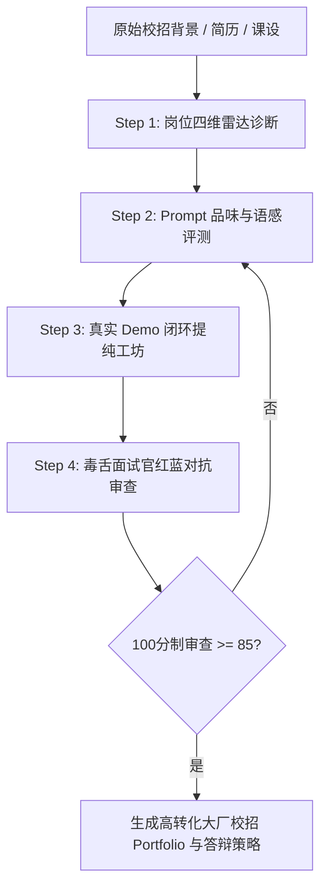

# AI Campus Navigator Architecture (核心技术架构)

## 1. 概述
AI Campus Navigator 是一套面向 AI 时代大厂校招生的综合定位、Prompt 品味淬炼、Demo 闭环包装与红蓝对抗质检的自动化 Agent Skill。

## 2. 四大引擎机制
1. **Taxonomy Classifier**：四象限分流（算法研究 / 工程加速 / AI PM / 业务复合）。
2. **Taste Evaluation Rubric**：参考腾讯 ACE 提出的“山水画自然语言场景还原”标准，评估候选人对复杂系统的文字驾驭力。
3. **Demo Closure Engine**：剔除代码玩具，强化数据闭环与 Badcase 迭代纪实。
4. **Adversarial Gatekeeper**：双 Agent 审查机制（资深架构师 + HR 甄选 PM），保障真实度与抗压能力。
